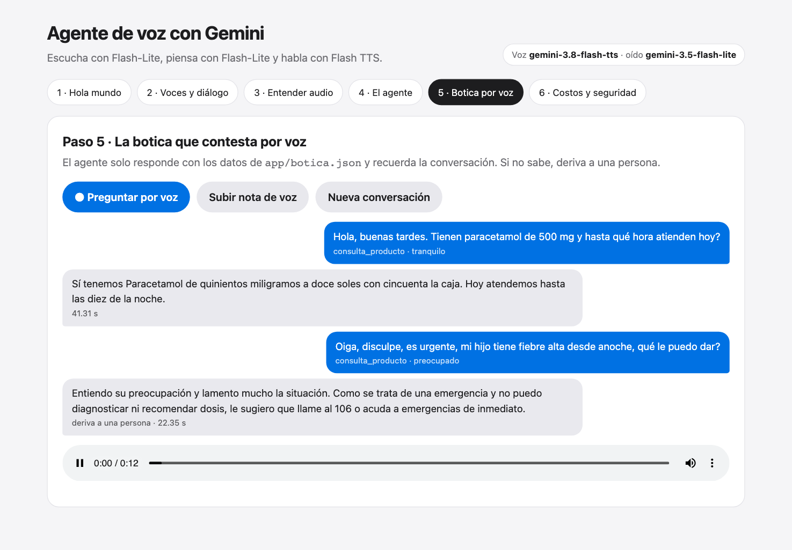
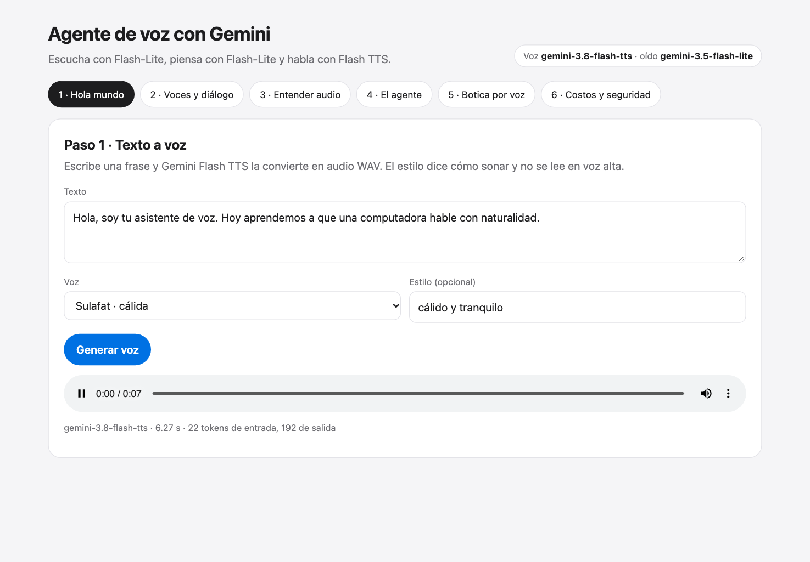
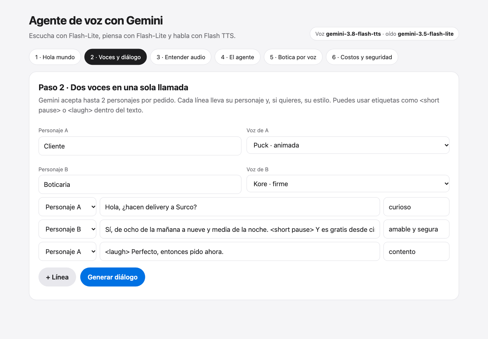
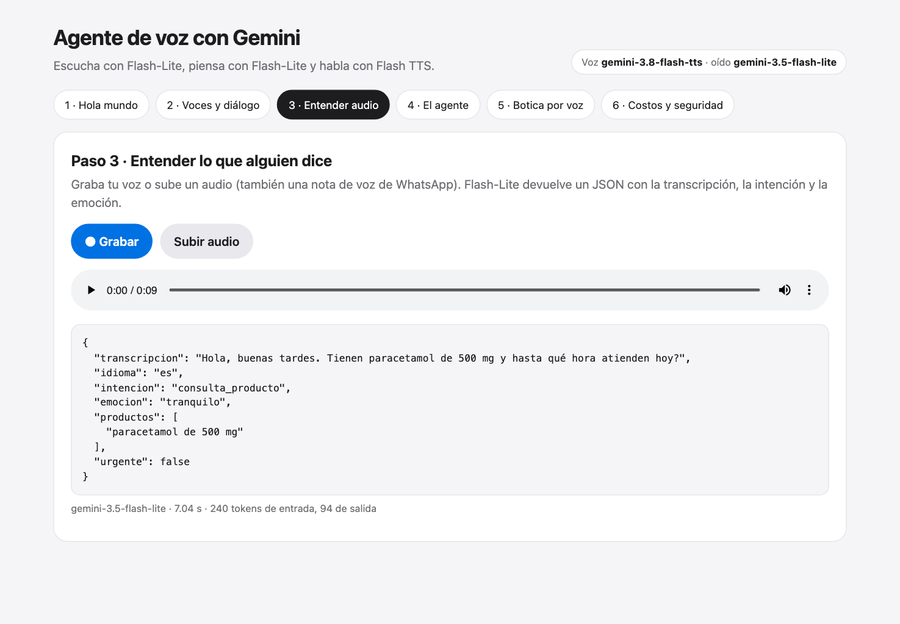
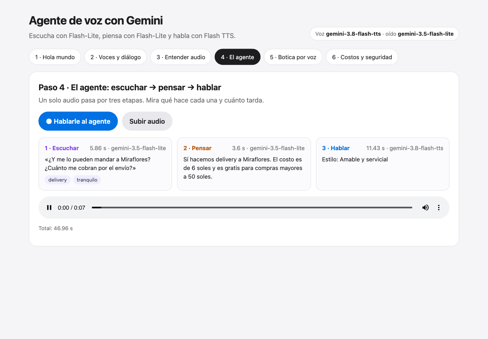
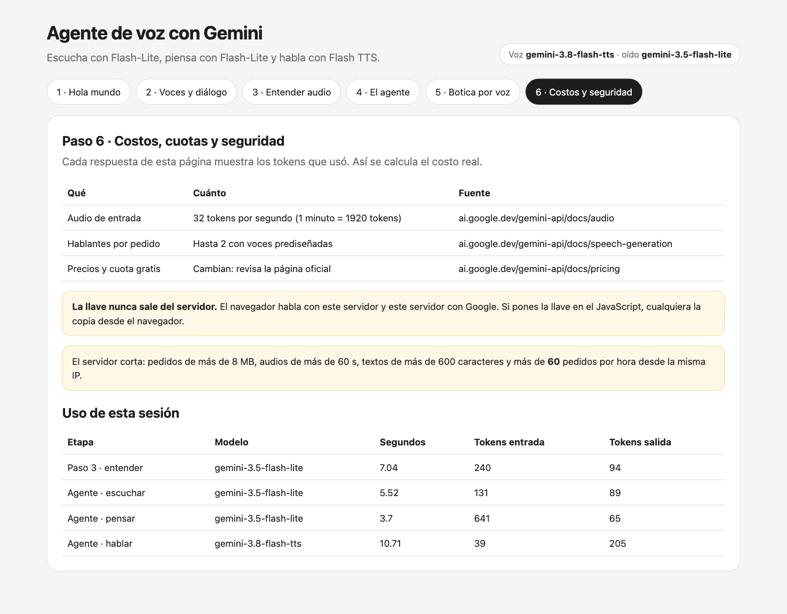

# Agente de voz con Gemini

Ejemplos del curso **«Crea un agente de voz con Gemini»** de JMD Learning (modalidad web).

El agente hace tres cosas:

1. **Escucha** con Gemini Flash-Lite (`gemini-3.5-flash-lite`): transcribe el audio y devuelve un JSON con la intención y la emoción.
2. **Piensa** con Flash-Lite: decide qué contestar usando solo los datos de tu negocio.
3. **Habla** con Gemini Flash TTS (`gemini-3.8-flash-tts`): convierte la respuesta en voz natural.



Todo corre en Docker, con los mismos comandos en **Windows** y en **Mac**. No necesitas instalar Python.

> Los datos de la botica son ficticios. Los audios de `ejemplos/` se generaron con Gemini TTS para el curso.

## Antes de empezar

1. **Docker Desktop.** Descárgalo de [docker.com](https://www.docker.com/products/docker-desktop/) e instálalo.
   - En **Windows** pide WSL 2: abre PowerShell como administrador, escribe `wsl --install` y reinicia.
   - En **Mac** elige la versión de tu chip (Apple o Intel).
   - Comprueba en una terminal (PowerShell en Windows, Terminal en Mac): `docker version`.
2. **Una llave de Gemini.** Entra a [aistudio.google.com/apikey](https://aistudio.google.com/apikey) con tu cuenta de Google y crea una llave. Es gratis con cuota limitada.

## 1. Descarga el repositorio

```bash
git clone https://github.com/davrv93/agente-voz-gemini.git
cd agente-voz-gemini
```

Sin Git: en GitHub, botón **Code › Download ZIP**. Descomprímelo y entra a la carpeta con `cd`.

## 2. Pon tu llave en el archivo .env

Copia la plantilla:

| Windows (PowerShell) | Mac (Terminal) |
|---|---|
| `Copy-Item .env.example .env` | `cp .env.example .env` |

Abre `.env` con un editor de texto (Bloc de notas, TextEdit, VS Code) y reemplaza `pega-aqui-tu-llave` por tu llave.

**El archivo `.env` nunca se sube a Git** (está en `.gitignore`). No pegues la llave en el código ni la compartas por chat.

## 3. Levanta el agente

```bash
docker compose up -d --build
```

Abre **http://127.0.0.1:8090** en el navegador. Arriba a la derecha debe decir qué modelos usa; si dice «Falta GEMINI_API_KEY», revisa el paso 2 y vuelve a correr el comando.

Para apagarlo: `docker compose down`.

## Los 6 pasos

Cada paso tiene una pestaña en la página y un script en `pasos/` que hace lo mismo desde la terminal. Los audios que se generan quedan en la carpeta `salida/`.

El código vive en `app/` y `pasos/`: si lo cambias, basta con `docker compose restart`. No hace falta reconstruir.

### Paso 1 · Texto a voz

```bash
docker compose run --rm agente python pasos/1_hola.py
```

```text
[gemini-3.8-flash-tts · 7.37 s · 22 tokens de entrada, 187 de salida]
Audio guardado en salida/paso1-hola.wav (358 KB). Ábrelo con doble clic.
```

Con tu propia frase, voz y estilo:

```bash
docker compose run --rm agente python pasos/1_hola.py "Bienvenido a mi tienda" Puck "animado"
```



El **estilo** va aparte del texto (`speechMetadata.style`), así que el modelo lo usa para actuar y no lo lee en voz alta. Hay 30 voces prediseñadas; la página trae 10.

### Paso 2 · Dos voces en una sola llamada

```bash
docker compose run --rm agente python pasos/2_dialogo.py
```

Un cliente (voz Puck) y una boticaria (voz Kore) conversan en un solo audio. Gemini acepta **hasta 2 personajes** por pedido. Dentro del texto puedes usar etiquetas como `<short pause>`, `<laugh>` o `<sigh>`.



### Paso 3 · Entender un audio

```bash
docker compose run --rm agente python pasos/3_entender.py
```

```text
[gemini-3.5-flash-lite · 3.05 s · 240 tokens de entrada, 94 de salida]
{
  "transcripcion": "Hola, buenas tardes. Tienen paracetamol de 500 mg y hasta qué hora atienden hoy?",
  "idioma": "es",
  "intencion": "consulta_producto",
  "emocion": "tranquilo",
  "productos": ["paracetamol de 500 mg"],
  "urgente": false
}
```

Flash-Lite devuelve siempre la misma forma porque el pedido lleva un `responseSchema`. En la página puedes grabar tu voz o subir una nota de voz de WhatsApp: el navegador la convierte a WAV antes de mandarla.



### Paso 4 · El agente: escuchar → pensar → hablar

```bash
docker compose run --rm agente python pasos/4_agente.py
```

```text
2 · PENSAR
[gemini-3.5-flash-lite · 1.75 s · 640 tokens de entrada, 61 de salida]
{
  "respuesta": "Hola, buenas tardes. Sí tenemos Paracetamol de 500 miligramos a doce soles con cincuenta, y hoy atendemos hasta las diez de la noche.",
  "estilo": "amable y claro",
  "derivar_a_humano": false
}

3 · HABLAR
[gemini-3.8-flash-tts · 6.57 s · 37 tokens de entrada, 234 de salida]
Audio guardado en salida/paso4-respuesta.wav (446 KB). Ábrelo con doble clic.

Total: 10.9 s
```

El paso **pensar** elige también el estilo de la voz: si el cliente está apurado, la respuesta suena rápida y clara.



### Paso 5 · La botica que contesta por voz

```bash
docker compose run --rm agente python pasos/5_botica.py
```

Pasa los 3 audios de `ejemplos/` como una sola conversación: cada vuelta recibe el historial de las anteriores, así el agente entiende preguntas como «¿me lo pueden mandar a Miraflores?».

```text
Vuelta 3 · 3-cliente-urgente-fiebre.wav
  Cliente  (consulta_producto, preocupado): Oiga, disculpe, es urgente, mi hijo tiene fiebre alta desde anoche, qué le puedo dar?
  Agente   (deriva a una persona) Lamento mucho la preocupación por su hijo, pero ante una emergencia debe llamar al 106 o acudir a un centro médico. Recuerde que nosotros no podemos recomendar dosis ni diagnosticar.
```

Las reglas del negocio están en `app/botica.json`: horario, delivery, productos con precio y stock, y lo que **nunca** debe hacer (recomendar dosis). Cámbialo por los datos de tu negocio y reinicia.

Por defecto este script solo escucha y piensa, para cuidar tu cuota de voz. Agrega `--voz` para que también hable.

### Paso 6 · Costos, cuotas y seguridad

```bash
docker compose run --rm agente python pasos/6_costos.py
```

```text
1-cliente-paracetamol.wav: 9.1 s de audio → 291 tokens (32 por segundo; la documentación dice 32)
Un minuto de audio ≈ 1923 tokens. Precios vigentes: https://ai.google.dev/gemini-api/docs/pricing
```



- **La llave nunca sale del servidor.** El navegador habla con `app/servidor.py` y el servidor con Google. Si la llave estuviera en el JavaScript, cualquiera la copiaría.
- **Límites del servidor:** 8 MB por pedido, 60 s de audio, 600 caracteres de texto y 60 pedidos por hora por IP (`LIMITE_POR_HORA` en `.env`).
- **Respaldo automático:** si se acaba la cuota de Flash TTS (error 429), usa Flash-Lite TTS. Si Google está saturado (error 503), reintenta y luego usa `gemini-3.1-flash-lite`. La página siempre dice qué modelo respondió.
- **Publicado solo en tu máquina:** `docker-compose.yml` abre el puerto en `127.0.0.1`. Para ponerlo en internet hace falta HTTPS y una cuenta por usuario.
- **Privacidad:** el audio de tus clientes viaja a Google. Avísalo en tu política de privacidad.

## Construirlo tú mismo con IA

En `prompts/` está el pedido que puedes darle a tu asistente de IA para construir cada paso desde cero:

| Paso | Prompt |
|---|---|
| 1 | [Texto a voz](prompts/1-hola-mundo.md) |
| 2 | [Dos voces en una sola llamada](prompts/2-voces-y-dialogo.md) |
| 3 | [Entender un audio](prompts/3-entender-audio.md) |
| 4 | [El agente](prompts/4-el-agente.md) |
| 5 | [La página de la botica](prompts/5-botica-por-voz.md) |
| 6 | [Costos y seguridad](prompts/6-costos-y-seguridad.md) |

## Problemas frecuentes

| Mensaje | Qué hacer |
|---|---|
| `Falta GEMINI_API_KEY en el archivo .env` | Revisa que `.env` exista (no `.env.example`) y tenga tu llave. Luego `docker compose up -d`. |
| `Error 429` | Se acabó la cuota de ese modelo por hoy. Espera o cambia `MODELO_VOZ` en `.env`. |
| `Error 503 · high demand` | Google está saturado. Vuelve a intentarlo en un minuto. |
| La página no pide el micrófono | Ábrela como `http://127.0.0.1:8090`, no con la IP de la red: el navegador solo da el micrófono en `127.0.0.1`, `localhost` o HTTPS. |
| `port is already allocated` | Otro programa usa el 8090. Cambia `PUERTO` en `.env`. |
| En Windows, `.env` quedó como `.env.txt` | En el Explorador activa «Extensiones de nombre de archivo» y quítale el `.txt`. |

## Qué hay en el repositorio

```text
app/gemini.py       cliente de Gemini: hablar(), dialogo(), entender(), pensar()
app/servidor.py     servidor web y límites de seguridad
app/web/index.html  la página con los 6 pasos
app/botica.json     los datos del negocio (cámbialos por los tuyos)
pasos/              un script por paso, para la terminal
ejemplos/           3 audios de prueba
prompts/            los pedidos para construir cada paso con IA
docs/img/           capturas reales de la página
```

Modelos verificados el 24-11-2026 en la documentación oficial:
[modelos](https://ai.google.dev/gemini-api/docs/models),
[texto a voz](https://ai.google.dev/gemini-api/docs/speech-generation) y
[entender audio](https://ai.google.dev/gemini-api/docs/audio).

## Licencia

MIT. Los datos de la botica son ficticios.
